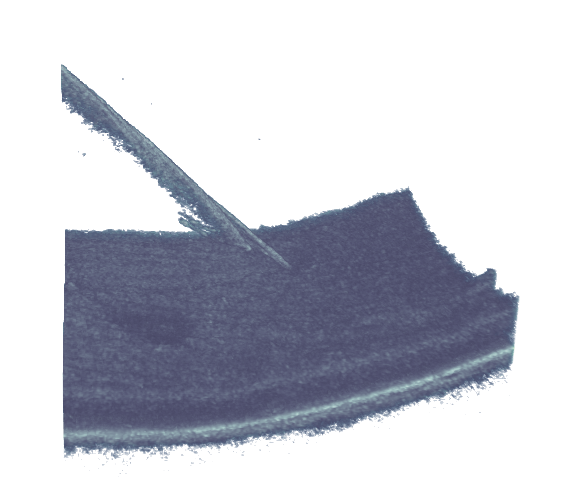

# Optical Coherence Tomography and Instrument Visualization

This TUM course exercise explores how OCT data can be inspected in slices and rendered as a volume. The [solution notebook](solution.ipynb) follows the exercise from slice extraction through instrument segmentation and 3D visualization.

| What to inspect | Example |
| --- | --- |
| Slice views | [OCT scan planes](images/ABC-scan.jpg) and [B-scan extraction](images/b-scan-extraction.png) |
| Instrument segmentation | [Segmentation illustration](images/InstrumentSeg.png) |
| 3D inspection | [OCT volume rendering](images/OCT_Volume_Rendering.png) |

